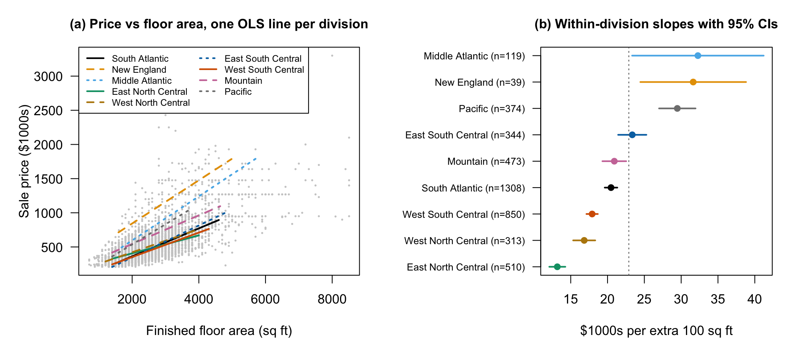
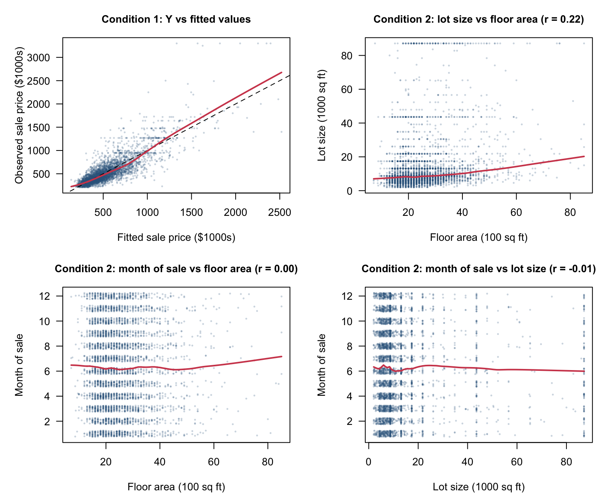
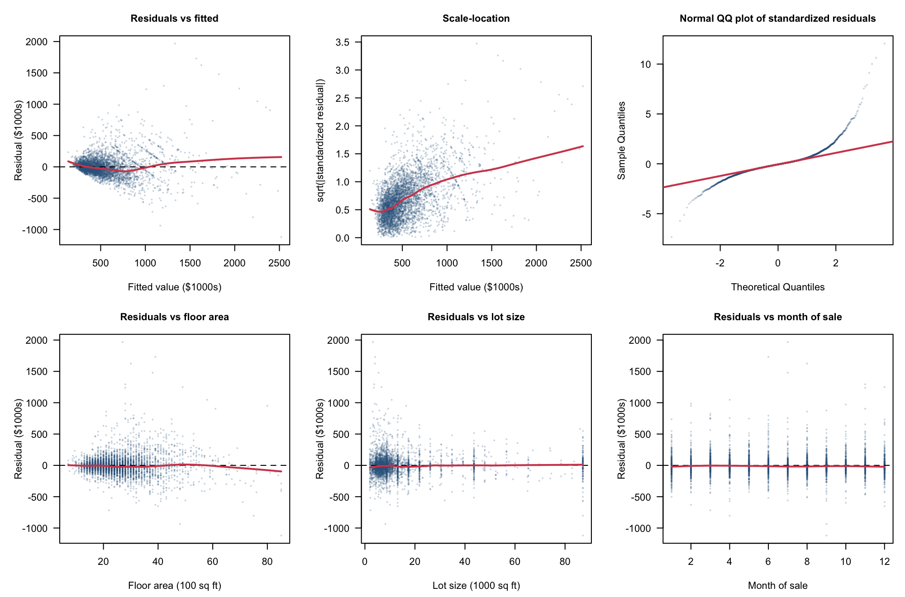
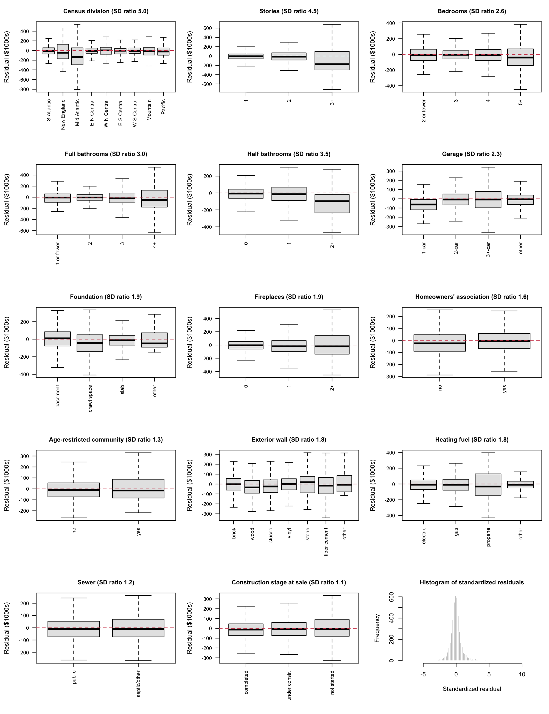

# Floor Area and Regional Differences in New Home Prices

STA302H1 Fall 2026 | Group 62 | Part 1 Research Proposal

## Contributions

Group 62

| Member name | Contribution to this proposal |
|---|---|
| Haiwen Yi | Research design, statistical analysis, and report writing. |
| Olivia Qi | __________ |
| __________ | __________ |
| __________ | __________ |

## Introduction

Among new detached, non-condominium homes sold in the United States in 2025, how is sale price associated with finished floor area, and does this association differ across the nine Census divisions after adjusting for lot size, room counts, amenities, construction features and sale timing? The response is sale price including land, measured in thousands of dollars; the focal predictors are floor area, measured in hundreds of square feet, Census division, and their interaction.

Three studies motivate this question. Rosen (1974) developed a competitive-market theory in which differentiated goods are priced as bundles of characteristics, providing a foundation for adjusting jointly for floor area, lot size, rooms and amenities. This theoretical result does not prescribe a linear price function. Gyourko and Saiz (2006) documented substantial construction-cost differences across US housing markets, jointly associated with local wages, unionization, topography and regulation. Because construction costs comprise much of new-house prices in most markets, these findings motivate examining geographic differences while controlling for structural characteristics. In a meta-regression of single-family housing studies, Sirmans et al. (2006) found that estimated floor-area coefficients varied by geographic location and by the number of predictors included in the model. This motivates comparing division-specific slopes under a common adjustment set.

These studies leave open whether a common area–price slope adequately summarizes new detached homes across the nine divisions within one dataset and adjustment set. We address this question using 2025 Survey of Construction records. Builders and housing analysts are the primary audience: the comparison can reveal whether applying one national slope obscures regional differences, subject to the limitations of an unweighted complete-case sample.

Regional mean prices or mean prices per square foot mix differences in housing composition with differences in conditional associations. Multiple linear regression adjusts for observed attributes and expresses area associations in dollars. We will estimate nine division-specific slopes and confidence intervals and test whether the eight interaction coefficients are jointly zero. The linear form is a preliminary approximation to be evaluated diagnostically. The estimates describe cross-house associations; they do not identify the causal return to enlarging a house.

## Data description

Census SOC 2025 surveys builders/owners using sampled permits and area canvassing to produce construction and sales statistics (Census Bureau, 2026). We retain 6,185 complete detached homes sold in 2025; 4,330 train and 1,855 test. Price is continuous but right-skewed, with disclosure-coded extremes. Distinct houses may share unobserved builders. Regional construction costs motivate area-by-division interaction (Gyourko & Saiz, 2006).

Table 1. Training summaries; N: mean(SD), C: counts by level; reference first. Missing cases excluded. Prices/lot sizes are skewed; rare categories require caution.

| Variable | Type | Summary |
|---|---|---|
| Price ($1000) | N | 527(307); median 433; range 210–3300 |
| Area (100sqft) | N | 25.4(9.9) |
| Lot (1000sqft) | N | 14.1(16.6) |
| Sale month | N | 6.3(3.4) |
| Division | C | SouthAtlantic:1308; NewEngland:39; MidAtlantic:119; EastNorthCentral:510; WestNorthCentral:313; EastSouthCentral:344; WestSouthCentral:850; Mountain:473; Pacific:374 |
| Stories | C | 1:2120; 2:2116; 3+:94 |
| Bedrooms | C | ≤2:154; 3:1780; 4:1777; 5+:619 |
| Full bathrooms | C | ≤1:46; 2:2664; 3:1203; 4+:417 |
| Half bathrooms | C | 0:2373; 1:1897; 2+:60 |
| Garage | C | 1:158; 2:3124; 3+:919; other:129 |
| Foundation | C | basement:992; crawl:403; slab:2926; other:9 |
| Fireplaces | C | 0:2781; 1:1383; 2+:166 |
| HOA | C | no:1109; yes:3221 |
| Age restriction | C | no:4216; yes:114 |
| Wall | C | brick:897; wood:169; stucco:906; vinyl:1362; stone:56; fiber-cement:926; other:14 |
| Heating | C | electric:2147; gas:2083; propane:52; other:48 |
| Sewer | C | public:3893; septic/other:437 |
| Sale stage | C | completed:2452; construction:1344; unstarted:534 |

## Ethics discussion

The first ethics module asks whether data are collected or simulated, whether metadata and original sources are documented, and whether third-party use supports trustworthiness. SOC records come from a documented Census survey, not simulated examples; the published definitions, sampling information and disclosure flags provide traceable metadata. Government origin supports provenance but does not remove sampling, reporting or measurement error.

For privacy, the public file suppresses detailed geography and identifying addresses and codes extreme values. We will not attempt re-identification or publish individual-house appraisals. Regarding consent, public statistical release is distinct from participants consenting to arbitrary new uses: we limit our use to aggregate housing research compatible with the collection purpose and do not claim to have independently audited every respondent's consent. Regarding ownership, we acknowledge the Census Bureau and HUD and retain source attribution. The estimates describe conditional associations; regional labels must not be used to stereotype households or imply causal effects of adding floor space.

## Preliminary results

Unweighted OLS includes 17 predictors and the area–division interaction (52 coefficients; n=4,330). Training R²=0.713 and adjusted R²=0.710. Adding the interaction increases R² by 0.020: two percentage points of explained training variation. Its conventional partial F-test is F(8,4278)=37.27, p<0.001.

Table 2 reports division slopes and contrasts. Holding other measured predictors fixed, an additional 100 square feet is associated with a fitted mean price increase of $11,834 in South Atlantic and $24,557 in Middle Atlantic. The estimated difference between these slopes is $12,723 per 100 square feet (95% CI: $10,359–$15,087; Appendix A). These are comparisons across homes. New England’s estimate warrants caution with only 39 observations.

For course Conditions 1–2, Figure 2 shows a broadly linear observed–fitted relationship and no pronounced curvature among numerical predictor pairs. Residual smoothers suggest mild nonlinearity: they bend around zero against fitted values and at large floor areas (Figure 3). Residual smoothers against lot size and sale month are comparatively flat. Constant variance fails: the residual fan and rising scale–location curve show increasing spread, while division residual SDs differ approximately fivefold (Figures 3–4). Normality fails: the Q–Q plot and histogram show heavy tails and right skew, with 36 standardized residuals outside ±4. Independence remains unverified because shared builders or subdivisions cannot be identified. Consequently, conventional standard errors, confidence intervals and the F-test remain provisional. No model corrections are applied here.

Regional slope heterogeneity agrees qualitatively with Sirmans et al. (2006). Gyourko and Saiz’s (2006) construction-cost differences provide context, but this model does not identify that mechanism. Unexpectedly, four-bedroom homes have lower fitted prices than homes with at most two bedrooms (−54.27; 95% CI: −86.95 to −21.59 in $1000s; Appendix A). This compares bedroom configurations at fixed area and other attributes, not the causal effect of adding bedrooms.

Lot size is imprecise (0.21; 95% CI: −0.17 to 0.60 in $1000s per 1,000 square feet), which does not establish zero land value.

Table 2. Adjusted area slopes (conventional SEs and 95% CIs) and contrasts versus South Atlantic (SEs); units: $1000 per 100 sq ft.

| Division | n | Slope | SE | 95% CI | Difference from South Atlantic (SE) |
|:----------------------|------:|------:|-----:|:---------------|:--------------------|
| South Atlantic (reference) | 1,308 | 11.83 | 0.63 | (10.60, 13.07) | — |
| New England | 39 | 19.26 | 2.15 | (15.05, 23.47) | 7.43 (2.17) |
| Middle Atlantic | 119 | 24.56 | 1.14 | (22.32, 26.79) | 12.72 (1.21) |
| East North Central | 510 | 6.85 | 0.85 | (5.19, 8.51) | −4.98 (0.91) |
| West North Central | 313 | 10.57 | 1.15 | (8.32, 12.82) | −1.26 (1.20) |
| East South Central | 344 | 13.78 | 0.97 | (11.88, 15.68) | 1.95 (1.00) |
| West South Central | 850 | 9.27 | 0.79 | (7.71, 10.82) | −2.57 (0.82) |
| Mountain | 473 | 14.60 | 0.80 | (13.03, 16.17) | 2.77 (0.87) |
| Pacific | 374 | 21.70 | 1.14 | (19.47, 23.92) | 9.86 (1.17) |

## Plan

Keep floor area, division and their interaction because they define the question; retain lot size on hedonic grounds (Rosen, 1974). Compare grouped backward selection by BIC with AIC and partial F-tests, preserving interaction hierarchy. Report disagreements rather than treating a significance threshold and BIC as identical rules. Use generalized variance inflation factors to assess collinearity.

Evaluate a Box–Cox transformation of price, including log price; compare log floor area if curvature persists. Recheck Conditions 1–2, residuals against fitted values and every predictor, constant variance and normality after each transformation and selection step. Investigate leverage, standardized residuals, Cook's distance, DFFITS and DFBETAS; remove observations only for documented errors. Assess remaining heteroscedasticity with HC3 and weighted least squares, including survey-weight sensitivity. Neither robust errors nor regional effects prove independence.

Freeze the final model before one test-set evaluation. Keep the test set unexamined during model development and distinguish 2024 replication from held-out 2025 validation.

| Completion date in 2026 | Task | Responsible member |
|---|---|---|
| November 12 | Transformations and diagnostics | Haiwen Yi |
| November 19 | Variable selection and influence checks | Haiwen Yi |
| November 22 | Robustness and frozen-model validation | Haiwen Yi |
| November 27 | Poster draft design | Olivia Qi |
| November 30 | Poster review | All members |
| December 2 | Record and review presentation | All members |
| December 3 | Final checks and submission | All members |

Table 3. Proposed team schedule in Toronto time; assign members before submission.

## Bibliography

Fox, J., & Weisberg, S. (2019). *An R companion to applied regression* (3rd ed.). Sage.

Gyourko, J., & Saiz, A. (2006). Construction costs and the supply of housing structure. *Journal of Regional Science, 46*(4), 661–680. https://doi.org/10.1111/j.1467-9787.2006.00472.x

R Core Team. (2025). *R: A language and environment for statistical computing* (Version 4.4.3) [Computer software]. R Foundation for Statistical Computing. https://www.R-project.org/

Rosen, S. (1974). Hedonic prices and implicit markets: Product differentiation in pure competition. *Journal of Political Economy, 82*(1), 34–55. https://doi.org/10.1086/260169

Sirmans, G. S., MacDonald, L., Macpherson, D. A., & Zietz, E. N. (2006). The value of housing characteristics: A meta analysis. *The Journal of Real Estate Finance and Economics, 33*, 215–240. https://doi.org/10.1007/s11146-006-9983-5

University of Toronto. (2026). *STA302 Embedded Ethics: Dataset ethics* [Course slides]. Quercus.

U.S. Census Bureau. (n.d.). *Survey of Construction microdata files: General information and variable descriptions* [Documentation]. https://www.census.gov/construction/chars/pdf/socmicro_info.pdf

U.S. Census Bureau. (2026). *Survey of Construction (SOC) microdata: 2025 annual file* [Data set]. https://www.census.gov/construction/chars/microdata.html

## Appendix A. All coefficients of the preliminary model

| Term | Estimate | SE | 95% CI |
|:--|--:|--:|:--|
| Intercept | 127.03 | 35.11 | (58.20, 195.86) |
| Floor area (per 100 sq ft) | 11.83 | 0.63 | (10.60, 13.07) |
| Division: New England | 355.76 | 76.85 | (205.09, 506.43) |
| Division: Middle Atlantic | −76.08 | 40.73 | (−155.92, 3.77) |
| Division: East North Central | 145.53 | 25.92 | (94.71, 196.35) |
| Division: West North Central | 34.89 | 32.17 | (−28.18, 97.96) |
| Division: East South Central | −39.31 | 27.28 | (−92.79, 14.18) |
| Division: West South Central | 33.91 | 23.00 | (−11.17, 79.00) |
| Division: Mountain | 81.27 | 25.37 | (31.53, 131.01) |
| Division: Pacific | −61.96 | 30.57 | (−121.89, −2.03) |
| Lot size (per 1000 sq ft) | 0.21 | 0.20 | (−0.17, 0.60) |
| Stories: 2 | −32.17 | 7.01 | (−45.91, −18.43) |
| Stories: 3+ | 211.47 | 19.53 | (173.17, 249.76) |
| Bedrooms: 3 | −35.26 | 15.73 | (−66.10, −4.42) |
| Bedrooms: 4 | −54.27 | 16.67 | (−86.95, −21.59) |
| Bedrooms: 5+ | −76.19 | 19.06 | (−113.56, −38.81) |
| Full bathrooms: 2 | 49.28 | 27.39 | (−4.41, 102.97) |
| Full bathrooms: 3 | 122.62 | 28.57 | (66.62, 178.63) |
| Full bathrooms: 4+ | 312.07 | 30.78 | (251.71, 372.42) |
| Half bathrooms: 1 | 48.75 | 6.81 | (35.41, 62.09) |
| Half bathrooms: 2+ | 172.85 | 23.90 | (125.99, 219.72) |
| Garage: 2-car | −60.46 | 14.35 | (−88.59, −32.32) |
| Garage: 3+-car | −33.40 | 16.08 | (−64.92, −1.88) |
| Garage: other | −44.13 | 20.08 | (−83.50, −4.75) |
| Foundation: crawl space | 91.67 | 11.23 | (69.64, 113.69) |
| Foundation: slab | −3.26 | 8.64 | (−20.19, 13.68) |
| Foundation: other | 36.24 | 57.46 | (−76.42, 148.90) |
| Fireplaces: 1 | 77.14 | 6.53 | (64.33, 89.95) |
| Fireplaces: 2+ | 93.55 | 14.50 | (65.13, 121.98) |
| Homeowners' association: yes | −11.59 | 6.65 | (−24.62, 1.44) |
| Age-restricted: yes | 27.14 | 16.95 | (−6.10, 60.37) |
| Exterior wall: wood | 19.68 | 15.69 | (−11.08, 50.44) |
| Exterior wall: stucco | 25.70 | 11.07 | (4.00, 47.39) |
| Exterior wall: vinyl | −31.32 | 9.71 | (−50.36, −12.28) |
| Exterior wall: stone | 13.42 | 23.28 | (−32.22, 59.05) |
| Exterior wall: fiber cement | 15.60 | 9.46 | (−2.94, 34.14) |
| Exterior wall: other | 52.35 | 45.44 | (−36.74, 141.44) |
| Heating fuel: gas | 21.83 | 6.80 | (8.51, 35.16) |
| Heating fuel: propane | −61.53 | 26.73 | (−113.94, −9.13) |
| Heating fuel: other | 9.10 | 25.77 | (−41.41, 59.62) |
| Sewer: septic or other | −13.59 | 10.66 | (−34.49, 7.32) |
| Stage at sale: under construction | −1.83 | 5.81 | (−13.22, 9.57) |
| Stage at sale: not started | 15.31 | 8.38 | (−1.11, 31.74) |
| Month of sale | 1.44 | 0.74 | (−0.02, 2.90) |
| Floor area × New England | 7.43 | 2.17 | (3.17, 11.68) |
| Floor area × Middle Atlantic | 12.72 | 1.21 | (10.36, 15.09) |
| Floor area × East North Central | −4.98 | 0.91 | (−6.76, −3.21) |
| Floor area × West North Central | −1.26 | 1.20 | (−3.62, 1.10) |
| Floor area × East South Central | 1.95 | 1.00 | (−0.02, 3.91) |
| Floor area × West South Central | −2.57 | 0.82 | (−4.18, −0.96) |
| Floor area × Mountain | 2.77 | 0.87 | (1.06, 4.47) |
| Floor area × Pacific | 9.86 | 1.17 | (7.56, 12.16) |

Table A1. Ordinary least squares estimates for the preliminary model (response: sale price in $1000s; training set, n = 4,330; R² = 0.713). Reference levels are listed in Table 1. Code: Part1_Code.Rmd.
