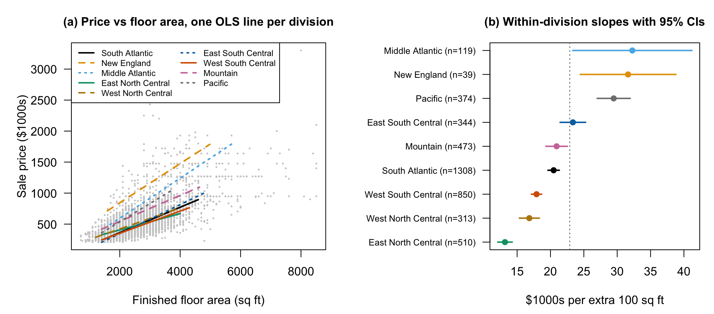
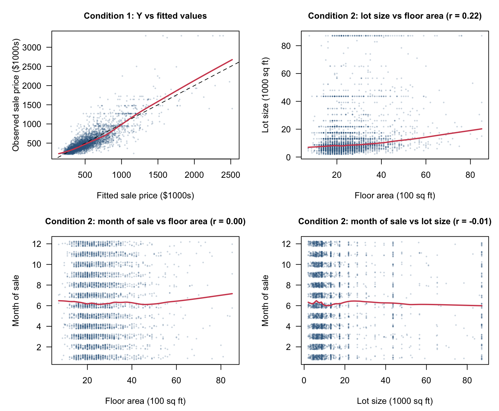
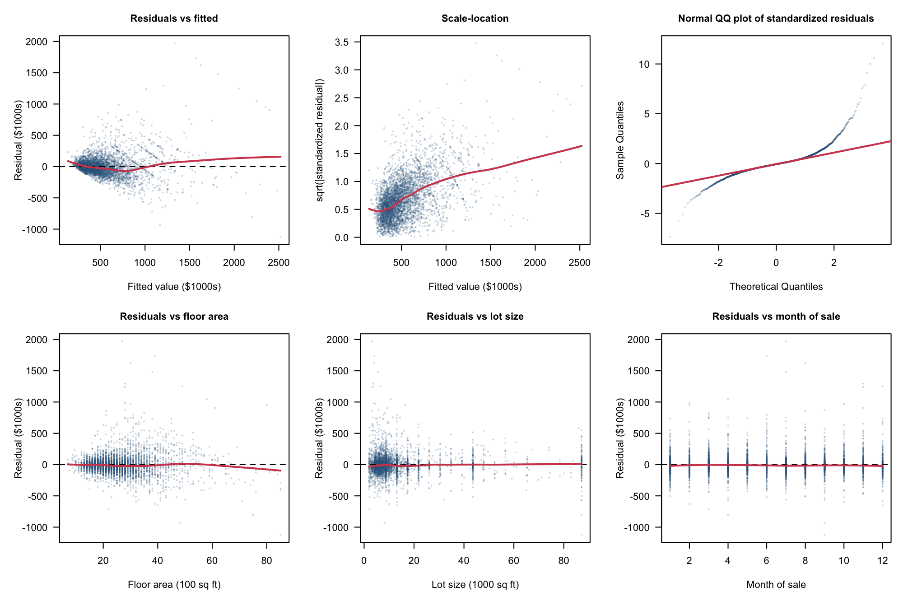
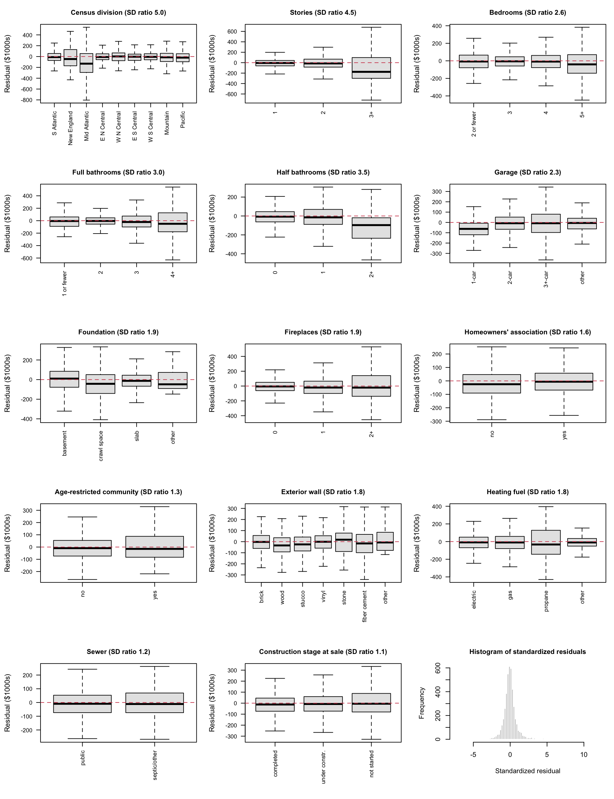

# Floor Area and Regional Differences in New Home Prices

STA302H1 Fall 2026 | Group 62 | Part 1 Research Proposal

## Contributions

Group 62

| Member name | Contribution to this proposal |
|---|---|
| __________ | __________ |
| __________ | __________ |
| __________ | __________ |
| __________ | __________ |

## Introduction

Among detached single-family homes sold in the United States in 2025, how is sale price associated with finished floor area, and does this association differ across the nine Census divisions after adjustment for lot size, rooms, amenities, construction features and sale timing? Sale price includes the lot and is measured in thousands of dollars; floor area is measured in hundreds of square feet.

Comparing average prices per square foot would mix regional differences with differences in housing characteristics. Multiple linear regression separates these conditional associations. A floor-area-by-division interaction estimates nine adjusted slopes. Their confidence intervals and the joint partial F-test of eight interaction coefficients answer the question. These are observational associations, not the causal return to adding space to a particular house.

Rosen (1974) developed a theoretical model in which differentiated goods trade at prices related to their characteristics. This motivates treating floor space and amenities as separate hedonic attributes; the theory does not itself establish a causal construction effect. Gyourko and Saiz (2006), studying US housing markets, found economically substantial variation in construction costs associated with wages, unionization, topography and regulation. This motivates regional differences while retaining structural controls. Glaeser et al. (2005) found that Manhattan housing prices substantially exceeded construction costs and presented evidence of supply restrictions in other US markets. Their high-rise setting differs from detached homes, so it motivates investigating regional heterogeneity rather than predicting our coefficients directly.

Our application brings these ideas to a recent national microdata sample, comparing all nine divisions within one specification. It does not claim that regional price differences are a new discovery. Builders and housing analysts can use the estimates to describe how the conditional value of space varies across the observed markets; buyers should not interpret them as individual appraisals.

## Data description

Census SOC 2025 surveys builders/owners using sampled permits and area canvassing to produce construction and sales statistics (Census Bureau, 2026). We retain 6,185 complete detached homes sold in 2025; 4,330 train and 1,855 test. Price is continuous but right-skewed, with disclosure-coded extremes. Distinct houses may share unobserved builders. Regional construction costs motivate area-by-division interaction (Gyourko & Saiz, 2006).

Table 1. Training summaries; N: mean(SD), C: counts by level; reference first. Missing cases excluded. Prices/lot sizes are skewed; rare categories require caution.

| Variable | Type | Summary |
|---|---|---|
| Price ($1000) | N | 527(307); median 433; range 210–3300 |
| Area (100sqft) | N | 25.4(9.9) |
| Lot (1000sqft) | N | 14.1(16.6) |
| Sale month | N | 6.3(3.4) |
| Division | C | SouthAtlantic:1308; NewEngland:39; MidAtlantic:119; EastNorthCentral:510; WestNorthCentral:313; EastSouthCentral:344; WestSouthCentral:850; Mountain:473; Pacific:374 |
| Stories | C | 1:2120; 2:2116; 3+:94 |
| Bedrooms | C | ≤2:154; 3:1780; 4:1777; 5+:619 |
| Full bathrooms | C | ≤1:46; 2:2664; 3:1203; 4+:417 |
| Half bathrooms | C | 0:2373; 1:1897; 2+:60 |
| Garage | C | 1:158; 2:3124; 3+:919; other:129 |
| Foundation | C | basement:992; crawl:403; slab:2926; other:9 |
| Fireplaces | C | 0:2781; 1:1383; 2+:166 |
| HOA | C | no:1109; yes:3221 |
| Age restriction | C | no:4216; yes:114 |
| Wall | C | brick:897; wood:169; stucco:906; vinyl:1362; stone:56; fiber-cement:926; other:14 |
| Heating | C | electric:2147; gas:2083; propane:52; other:48 |
| Sewer | C | public:3893; septic/other:437 |
| Sale stage | C | completed:2452; construction:1344; unstarted:534 |

## Ethics discussion

The first ethics module asks whether data are collected or simulated, whether metadata and original sources are documented, and whether third-party use supports trustworthiness. SOC records come from a documented Census survey, not simulated examples; the published definitions, sampling information and disclosure flags provide traceable metadata. Government origin supports provenance but does not remove sampling, reporting or measurement error.

For privacy, the public file suppresses detailed geography and identifying addresses and codes extreme values. We will not attempt re-identification or publish individual-house appraisals. Regarding consent, public statistical release is distinct from participants consenting to arbitrary new uses: we limit our use to aggregate housing research compatible with the collection purpose and do not claim to have independently audited every respondent's consent. Regarding ownership, we acknowledge the Census Bureau and HUD and retain source attribution. The estimates describe conditional associations; regional labels must not be used to stereotype households or imply causal effects of adding floor space.

## Preliminary results

OLS uses 17 predictors plus the interaction (52 coefficients; n=4,330). R²=0.713 and adjusted R²=0.710; the interaction adds 0.020, F(8,4278)=37.3. Table 2 reports conditional slopes with conventional uncertainty, which is provisional under the violations below.

Conditions 1–2 are approximately satisfied: observed versus fitted prices are broadly linear and numerical predictor pairs lack strong curvature (Figure 2). Linearity is mildly violated by bending residual smoothers. Constant variance fails: residuals fan out and group spreads differ approximately fivefold. Normality fails: the Q–Q upper tail is heavy, with 36 standardized residuals beyond ±4 (Figures 3–4). Independence is not established because subdivision/builder identifiers are unavailable. No remedies are applied here.

Regional differences are compatible with Gyourko and Saiz (2006) and Glaeser et al. (2005), without demonstrating construction-cost or regulatory mechanisms. Lot size is unexpectedly inconclusive (p=0.28); the negative bedroom association conditions on fixed area. Sparse New England observations make that slope uncertain.

Table 2. Preliminary estimates, standard errors and 95% confidence intervals.

| Division | n | Slope | SE | 95% CI | Difference from South Atlantic (SE) |
|:----------------------|------:|------:|-----:|:---------------|:--------------------|
| South Atlantic (reference) | 1,308 | 11.83 | 0.63 | (10.60, 13.07) | — |
| New England | 39 | 19.26 | 2.15 | (15.05, 23.47) | 7.43 (2.17) |
| Middle Atlantic | 119 | 24.56 | 1.14 | (22.32, 26.79) | 12.72 (1.21) |
| East North Central | 510 | 6.85 | 0.85 | (5.19, 8.51) | −4.98 (0.91) |
| West North Central | 313 | 10.57 | 1.15 | (8.32, 12.82) | −1.26 (1.20) |
| East South Central | 344 | 13.78 | 0.97 | (11.88, 15.68) | 1.95 (1.00) |
| West South Central | 850 | 9.27 | 0.79 | (7.71, 10.82) | −2.57 (0.82) |
| Mountain | 473 | 14.60 | 0.80 | (13.03, 16.17) | 2.77 (0.87) |
| Pacific | 374 | 21.70 | 1.14 | (19.47, 23.92) | 9.86 (1.17) |

## Plan

Keep floor area, division and their interaction because they define the question; retain lot size on hedonic grounds (Rosen, 1974). Compare grouped backward selection by BIC with AIC and partial F-tests, preserving interaction hierarchy. Report disagreements rather than treating a significance threshold and BIC as identical rules. Use generalized variance inflation factors to assess collinearity.

Evaluate a Box–Cox transformation of price, including log price; compare log floor area if curvature persists. Recheck Conditions 1–2, residuals against fitted values and every predictor, constant variance and normality after each transformation and selection step. Investigate leverage, standardized residuals, Cook's distance, DFFITS and DFBETAS; remove observations only for documented errors. Assess remaining heteroscedasticity with HC3 and weighted least squares, including survey-weight sensitivity. Neither robust errors nor regional effects prove independence.

Freeze the final model before one test-set evaluation. Disclose full-sample descriptive inspection before the split and distinguish 2024 replication from held-out 2025 validation.

| Completion date in 2026 | Task | Responsible member |
|---|---|---|
| November 12 | Transformations and diagnostics | __________ |
| November 19 | Variable selection and influence checks | __________ |
| November 22 | Robustness and frozen-model validation | __________ |
| November 27 | Poster draft | __________ |
| November 30 | Poster review | __________ |
| December 2 | Record and review presentation | __________ |
| December 3 | Final checks and submission | __________ |

Table 3. Proposed team schedule in Toronto time; assign members before submission.

## Bibliography

Fox, J., & Weisberg, S. (2019). *An R companion to applied regression* (3rd ed.). Sage.

Glaeser, E. L., Gyourko, J., & Saks, R. (2005). Why is Manhattan so expensive? Regulation and the rise in housing prices. *The Journal of Law and Economics, 48*(2), 331–369. https://doi.org/10.1086/429979

Gyourko, J., & Saiz, A. (2006). Construction costs and the supply of housing structure. *Journal of Regional Science, 46*(4), 661–680. https://doi.org/10.1111/j.1467-9787.2006.00472.x

R Core Team. (2025). *R: A language and environment for statistical computing* (Version 4.4.3) [Computer software]. R Foundation for Statistical Computing. https://www.R-project.org/

Rosen, S. (1974). Hedonic prices and implicit markets: Product differentiation in pure competition. *Journal of Political Economy, 82*(1), 34–55. https://doi.org/10.1086/260169

U.S. Census Bureau. (n.d.). *Survey of Construction microdata files: General information and variable descriptions* [Documentation]. https://www.census.gov/construction/chars/pdf/socmicro_info.pdf

U.S. Census Bureau. (2026). *Survey of Construction (SOC) microdata: 2025 annual file* [Data set]. https://www.census.gov/construction/chars/microdata.html

University of Toronto. (2026). *STA302 Embedded Ethics: Dataset ethics* [Course slides]. Quercus.

## Appendix A. All coefficients of the preliminary model

| Term | Estimate | SE | 95% CI |
|:--|--:|--:|:--|
| Intercept | 127.03 | 35.11 | (58.20, 195.86) |
| Floor area (per 100 sq ft) | 11.83 | 0.63 | (10.60, 13.07) |
| Division: New England | 355.76 | 76.85 | (205.09, 506.43) |
| Division: Middle Atlantic | −76.08 | 40.73 | (−155.92, 3.77) |
| Division: East North Central | 145.53 | 25.92 | (94.71, 196.35) |
| Division: West North Central | 34.89 | 32.17 | (−28.18, 97.96) |
| Division: East South Central | −39.31 | 27.28 | (−92.79, 14.18) |
| Division: West South Central | 33.91 | 23.00 | (−11.17, 79.00) |
| Division: Mountain | 81.27 | 25.37 | (31.53, 131.01) |
| Division: Pacific | −61.96 | 30.57 | (−121.89, −2.03) |
| Lot size (per 1000 sq ft) | 0.21 | 0.20 | (−0.17, 0.60) |
| Stories: 2 | −32.17 | 7.01 | (−45.91, −18.43) |
| Stories: 3+ | 211.47 | 19.53 | (173.17, 249.76) |
| Bedrooms: 3 | −35.26 | 15.73 | (−66.10, −4.42) |
| Bedrooms: 4 | −54.27 | 16.67 | (−86.95, −21.59) |
| Bedrooms: 5+ | −76.19 | 19.06 | (−113.56, −38.81) |
| Full bathrooms: 2 | 49.28 | 27.39 | (−4.41, 102.97) |
| Full bathrooms: 3 | 122.62 | 28.57 | (66.62, 178.63) |
| Full bathrooms: 4+ | 312.07 | 30.78 | (251.71, 372.42) |
| Half bathrooms: 1 | 48.75 | 6.81 | (35.41, 62.09) |
| Half bathrooms: 2+ | 172.85 | 23.90 | (125.99, 219.72) |
| Garage: 2-car | −60.46 | 14.35 | (−88.59, −32.32) |
| Garage: 3+-car | −33.40 | 16.08 | (−64.92, −1.88) |
| Garage: other | −44.13 | 20.08 | (−83.50, −4.75) |
| Foundation: crawl space | 91.67 | 11.23 | (69.64, 113.69) |
| Foundation: slab | −3.26 | 8.64 | (−20.19, 13.68) |
| Foundation: other | 36.24 | 57.46 | (−76.42, 148.90) |
| Fireplaces: 1 | 77.14 | 6.53 | (64.33, 89.95) |
| Fireplaces: 2+ | 93.55 | 14.50 | (65.13, 121.98) |
| Homeowners' association: yes | −11.59 | 6.65 | (−24.62, 1.44) |
| Age-restricted: yes | 27.14 | 16.95 | (−6.10, 60.37) |
| Exterior wall: wood | 19.68 | 15.69 | (−11.08, 50.44) |
| Exterior wall: stucco | 25.70 | 11.07 | (4.00, 47.39) |
| Exterior wall: vinyl | −31.32 | 9.71 | (−50.36, −12.28) |
| Exterior wall: stone | 13.42 | 23.28 | (−32.22, 59.05) |
| Exterior wall: fiber cement | 15.60 | 9.46 | (−2.94, 34.14) |
| Exterior wall: other | 52.35 | 45.44 | (−36.74, 141.44) |
| Heating fuel: gas | 21.83 | 6.80 | (8.51, 35.16) |
| Heating fuel: propane | −61.53 | 26.73 | (−113.94, −9.13) |
| Heating fuel: other | 9.10 | 25.77 | (−41.41, 59.62) |
| Sewer: septic or other | −13.59 | 10.66 | (−34.49, 7.32) |
| Stage at sale: under construction | −1.83 | 5.81 | (−13.22, 9.57) |
| Stage at sale: not started | 15.31 | 8.38 | (−1.11, 31.74) |
| Month of sale | 1.44 | 0.74 | (−0.02, 2.90) |
| Floor area × New England | 7.43 | 2.17 | (3.17, 11.68) |
| Floor area × Middle Atlantic | 12.72 | 1.21 | (10.36, 15.09) |
| Floor area × East North Central | −4.98 | 0.91 | (−6.76, −3.21) |
| Floor area × West North Central | −1.26 | 1.20 | (−3.62, 1.10) |
| Floor area × East South Central | 1.95 | 1.00 | (−0.02, 3.91) |
| Floor area × West South Central | −2.57 | 0.82 | (−4.18, −0.96) |
| Floor area × Mountain | 2.77 | 0.87 | (1.06, 4.47) |
| Floor area × Pacific | 9.86 | 1.17 | (7.56, 12.16) |

Table A1. Ordinary least squares estimates for the preliminary model (response: sale price in $1000s; training set, n = 4,330; R² = 0.713). Reference levels are listed in Table 1. Code: Part1_Code.Rmd.
